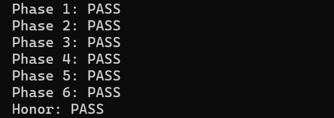

# BombLab 实验报告

## 实验对象、工具与辅助使用说明

- 实验仓库：<https://github.com/chuan-qi-niu-pai/BombLab>
- 个人炸弹 package：`f82a5b3ae1197c17b128d4eb`。
- 环境：Windows 下的 WSL，使用 GCC、GNU objdump、Python 3 和 Git。
- 代码修改仅位于 `defuser.c`；未修改个人炸弹、求解接口、驱动、测试或工作流。
- 辅助使用说明：本次使用 OpenAI Codex 读取个人炸弹的反汇编与数据段、恢复计算关系、生成求解代码、整理本文及补充验证脚本。本文的计算分析和代码不是本人独立推导的成果；本人在 WSL 中运行编译、公开测试和补充测试，并提供实际输出。对原理的复核与理解应与这些工具生成内容明确区分。本说明不代表课程认可这种使用方式，提交前需按课程要求复核。

以下 `C` 表示传入的 64 位 `challenge`，`U32(x)` 表示取低 32 位。所有 32 位加法、乘法和左移均使用 `uint32_t`，按模 `2^32` 计算；右移为逻辑右移。`^` 表示按位异或。答案根据每次传入的 challenge 计算，不保存某一个 seed 的固定答案。

## 第一关：调用参数与返回值

`phase_01` 在 `0x4020ce` 调用 `sscanf` 读入一个整数；`0x4020db` 调用 `p1_compute`；`0x4020e0` 将输入与 `eax` 比较。因此目标是恢复计算函数的返回值。

`p1_compute` 先保存 challenge，通过右移 32 位、右移 16 位得到不同片段。`p1_step1`、`p1_step0`、`p1_step2` 按此顺序调用，参数由 `edi`、`esi` 传递，结果从 `eax` 取得。`lea` 在这里计算加法与倍乘，而非读取内存。

令 `L=U32(C)`、`H=U32(C>>32)`、`M=U32(C>>16)`，则：

```text
s1 = U32(M + 0xf0d9) ^ H
s0 = U32(L + 8*H) ^ 0x9cfd
answer = U32((s1 ^ 0xea2f) + 8*s0)
```

关键依据是 `0x402024` 的 `lea eax,[rdi+rsi*8]`、`0x402034` 的加常数，以及 `0x402044` 的异或和随后倍乘。输出一个无符号整数。

## 第二关：循环与递推

`phase_02` 先要求六个无符号整数。`0x402160` 至 `0x402167` 对 challenge 右移 20 位后与 `0x3f`，得到第一项。循环中 `cl` 从 7 开始，每次加 2；异或常数从 10 开始，每次加 10。

```text
a[0] = (C >> 20) & 63
a[i] = U32(a[i-1] + ((C >> (5 + 2*i)) & 63)) ^ (10*i), i=1..5
```

`0x402182` 先加前一项，`0x402187` 再异或，运算顺序不能交换。输出这六项。

## 第三关：switch 与跳转表

`0x402311` 使用 challenge 的低三位选分支。另一个参数为 `X=U32(C>>3)^U32(C>>32)`。`p3_dispatch` 在 `0x40226d` 间接跳转，表位于 `0x405820`。

表内存放的是跳转块地址，不能直接按辅助函数名字中的编号排列。追踪这些跳转块，得到实际顺序 `4,2,3,1,6,7,0,5`：

| 输入序号 | 目标辅助函数 | 计算结果（取低32位） |
|---|---|---|
| 0 | p3_case_4 | `3*X + 0xc0fd` |
| 1 | p3_case_2 | `3*X + 0xd802` |
| 2 | p3_case_3 | `5*X + 0x1402d` |
| 3 | p3_case_1 | `(X ^ 0x57b8) + (X >> 1)` |
| 4 | p3_case_6 | `(4*X) ^ 0x8e3c` |
| 5 | p3_case_7 | `5*X + 0x2ab6b` |
| 6 | p3_case_0 | `(4*X) ^ 0x999c` |
| 7 | p3_case_5 | `(X ^ 0xb2d5) + (X >> 2)` |

输出两个整数：分支序号与计算结果。

## 第四关：递归返回过程

目标值 `T=C&127`，初始范围为 `[0,127]`，参数 `K=U32(C>>7)^U32(C>>32)`。`p4_walk` 计算中点 `mid=low+((high-low)>>1)` 并根据无符号比较决定方向。

```text
T == mid: return U32(mid + 0xac) ^ K
T < mid:  return U32(3*walk(T,low,mid-1,K)) ^ U32(mid+K) ^ 0x17
T > mid:  return U32(3*walk(T,mid+1,high,K)) ^ U32(mid+K) ^ 0x13
```

`0x402394` 的左分支常数是 `0x17`，`0x402376` 的右分支常数是 `0x13`。每层在递归返回后做倍乘与异或，不能只统计路径长度，也不能遗漏每层中点。输出递归返回值。

## 第五关：结构体与链表

`p5_traverse` 通过 `0x405b60` 的指针表选起点。节点布局由三次访问恢复：偏移 0 为32位 value，偏移4为32位 tag，偏移8为64位 next 指针；每个节点占16字节。

起点序号为 `C&7`；移动次数为 `(C>>3)&3`，因此参与折叠的节点数是该值加一。初始累加值为：

```text
acc = U32(C>>6) ^ U32(C>>32) ^ 0xbdba
```

包括起点在内，每个节点都执行：

```text
acc = U32((acc + node.value) * 5) ^ node.tag
```

依据为 `0x402463` 的加 value、`0x402465` 的乘5与 `0x40246b` 的异或 tag。`next` 的实际指针决定后续节点，不能按内存中相邻地址遍历。以 `0x405ba0` 为节点0、每16字节编号，八个起点编号是 `10,6,11,2,9,1,7,8`。

输出两个整数：最终 acc 和最后一个访问节点的 tag。代码中的固定节点值与指针关系来自个人炸弹的数据段，而每次选择的起点、访问长度和初值均取决于 challenge。

## 第六关：函数指针表与间接调用

`p6_dispatch` 的函数指针表在 `0x405e00`，按索引排列为 `op1,op0,op5,op3,op2,op0,op4,op2`。两次调用分别使用 challenge 的第0～2位和第3～5位。

```text
X = U32(C>>6) ^ U32(C>>32)
Y = table[C&7](X) ^ 0x3270
answer = U32(table[(C>>3)&7](Y) + 0x9c3b)
```

辅助函数为：

| 函数 | 运算（32位） |
|---|---|
| op0 | `(X+0xf0bb) ^ (X>>1)` |
| op1 | `ROL32(X,5) ^ 0xe20e` |
| op2 | `(X^0xf5c7) + (X<<5)` |
| op3 | `((X>>1)^X) + 0x3ab7` |
| op4 | `ROR32(X,7)` |
| op5 | `(8*X+0x2fe3) ^ (5*X)` |

循环移位不能替换成普通移位；代码分别用两个互补方向的位移再按位或实现。

## Honor：文本布局与前六关上下文

`secret_gate` 将文本复制到 `rbp-0xd0` 开始的区域，在 `rbp-0xb0` 检查四字节 `0x4e45504f`。偏移差为32，小端字节序对应 `OPEN`。之后从 `rbp-0xac`，即输入偏移36处，调用 `secret_phase`，它要求三个整数。

因此输出使用32个 `A` 作为前缀，然后接 `OPEN`、空格及三个十进制整数。文本长度落在门控检查的36～163字节范围内；不写入保存的返回地址。

设 `Q=context`，由驱动对前六关答案计算后传入，不能忽略。根据 `0x4026b0` 至 `0x402702`：

```text
A = U32(C) ^ U32(C>>32)
B = U32(Q) ^ U32(Q>>32)
S = Q & 3
X = A ^ B
Y = U32(((X>>1)^0x1636) + (X^0x4de6))
Y = Y ^ U32(S*0x4de6) ^ U32(Q>>16)
Z = Y ^ U32((A>>1) + B + S + 0x1636)
```

三个数字为 `S Y Z`。程序中出现的自然语言字符串不是计算依据；本实现依据实际执行指令、比较条件及引用的数据表恢复逻辑。

## 实际验证记录

以下结果来自本人在 WSL 运行程序后保存的日志，不是推测的测试结果。编译使用模板的 `make`，保留 `-Wall -Wextra -Wpedantic -Werror`。

| 验证项目 | 结果 |
|---|---|
| 教学关 Phase 0 | 10/10 PASS |
| 六关公开测试 | 60/60 PASS |
| Honor 公开测试 | 10/10 PASS |
| 非公开 seed 314159：六关及 Honor | 7/7 PASS |
| 非公开 seed 271828：六关及 Honor | 7/7 PASS |
| 非公开 seed 20261030：六关及 Honor | 7/7 PASS |
| 每关128个额外 challenge，共六关 | 768/768 PASS |
| 补充检查合计 | 789/789 PASS |

补充 challenge 为 `0xFEDCBA9876543200 | low`，其中 `low` 遍历0～127。这覆盖第三关所有跳转表索引、第四关全部目标值、第五关全部起点与长度组合，以及第六关两次索引的全部组合。高位固定，所以这不等同于穷尽所有64位输入；公开测试和三个额外 seed 还提供了不同高位的验证。

公开测试日志：[public-test.log](public-test.log)。补充测试日志：[extra-test.log](extra-test.log)。复现补充测试：在仓库根目录运行 `python3 verify_extra.py`。

验证版本的 `defuser.c` SHA-256：

```text
37a9b20a7af7ac74e2152656cb4e2098100724f6cb62455262e59ecc40a4ca68
```

运行截图（需将真实终端截图保存为以下路径并一起提交）：



## 参考资料

1. [课程实验说明](https://ics-26fall-fdu.github.io/labs/lab2-bomb-lab/)。
2. [模板仓库README](https://github.com/ICS-26Fall-FDU/BombLab#readme)：接口、验证方式、报告及final标签要求。
3. 个人炸弹的 `objdump -d -M intel` 反汇编，以及 `.rodata`、`.data` 段转储：本文计算关系与常数的直接来源。
4. 仓库内 `defuser.h`、`defuser_main.c`、`challenge.c`、`public_test.py`：接口、上下文传递、公开验证流程。
5. OpenAI Codex：辅助用途见报告开头的披露。
